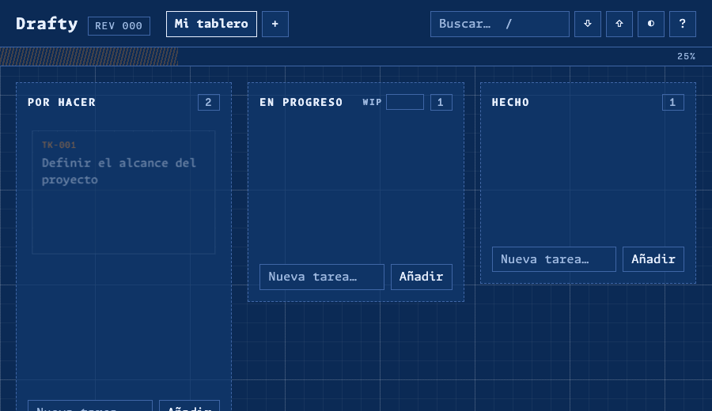
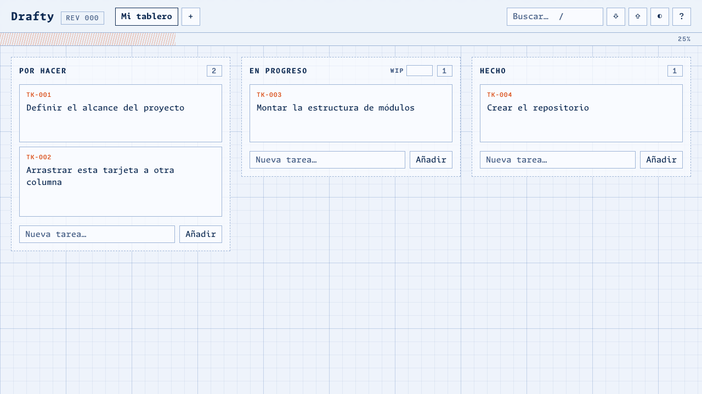
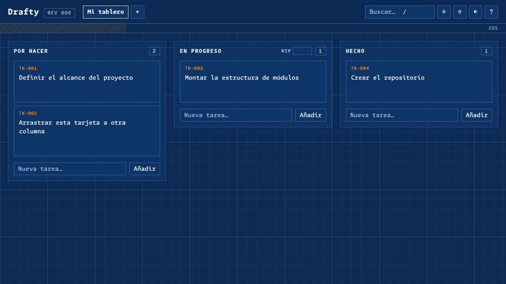
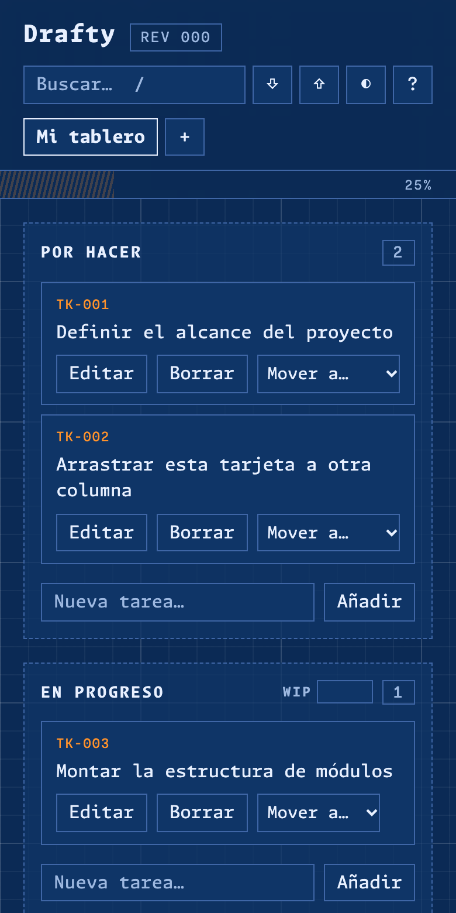
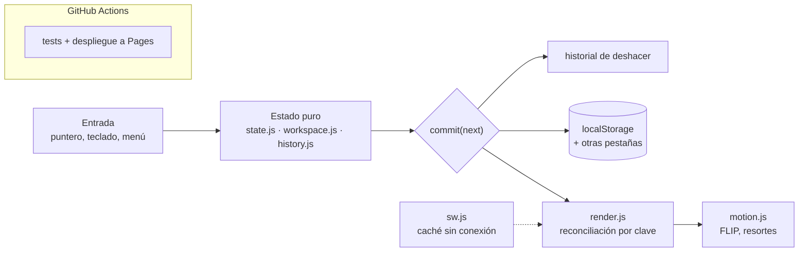

# Drafty

**Un tablero Kanban con estética de plano técnico, arrastrar y soltar con pointer events, animaciones con Motion y funcionamiento sin conexión, en JavaScript puro.**

[](https://github.com/zSamir015/drafty/actions/workflows/test.yml)
[](LICENSE)

[English](README.md) | **Español**

Drafty es un tablero Kanban con aspecto de plano técnico. Está escrito en JavaScript sin frameworks ni paso de build, y la interfaz está en español.

La parte interesante es la interacción: el arrastrar y soltar usa eventos de puntero en lugar de la API de arrastre de HTML5, el tablero se vuelve a dibujar reconciliando nodos con clave, y todo cambio pasa por una única función que guarda el historial, persiste y redibuja. Todo funciona con teclado y sin conexión.

**[Demo en vivo →](https://zsamir015.github.io/drafty/)** · [Política de seguridad](SECURITY.md)



| Claro                                                | Oscuro                                              | Móvil                                |
| ---------------------------------------------------- | --------------------------------------------------- | ------------------------------------ |
|  |  |  |

## Stack técnico

[](#cómo-funciona)

Módulos ES de JavaScript · HTML · CSS · Motion (incluido en el repo) · Service worker + Web App Manifest · node --test · GitHub Actions + Pages

## Inicio rápido

```sh
git clone https://github.com/zSamir015/drafty.git && cd drafty
npm run dev   # http://localhost:5173
npm test
```

## Contenido

- [Funciones](#funciones)
- [Cómo funciona](#cómo-funciona)
- [Arrastrar y soltar](#arrastrar-y-soltar)
- [Renderizado y animación](#renderizado-y-animación)
- [Almacenamiento y formato de datos](#almacenamiento-y-formato-de-datos)
- [Funcionamiento sin conexión](#funcionamiento-sin-conexión)
- [Seguridad](#seguridad)
- [Accesibilidad](#accesibilidad)
- [Tests e integración continua](#tests-e-integración-continua)
- [Ejecutarlo en local](#ejecutarlo-en-local)
- [Estructura del proyecto](#estructura-del-proyecto)
- [Limitaciones](#limitaciones)
- [Licencia y créditos](#licencia-y-créditos)

## Funciones

- Tres columnas (por hacer, en progreso, hecho) y varios tableros en pestañas. Los tableros se crean, se renombran con doble clic y se borran.
- Tarjetas con título, prioridad, etiqueta y fecha de entrega. Las vencidas se marcan.
- Arrastrar y soltar con ratón o táctil (pulsación larga en táctil). `Esc` cancela el arrastre, y la página se desplaza al arrastrar cerca del borde superior o inferior.
- Deshacer y rehacer con `Ctrl+Z` y `Ctrl+Shift+Z`, hasta 100 pasos. Al borrar una tarjeta aparece además un aviso con "Deshacer".
- Búsqueda en vivo por título, etiqueta o código de tarjeta (por ejemplo `TK-007`).
- Límite de trabajo en curso en la columna "en progreso", que se resalta cuando se supera.
- Barra de progreso y un cajetín que cuenta las revisiones, en línea con el estilo de plano.
- Exportación e importación en JSON de todo el espacio de trabajo.
- Los cambios hechos en una pestaña aparecen en las demás pestañas abiertas.
- Tema claro y oscuro, con View Transition cuando el navegador lo admite.
- Instalable como PWA y usable sin conexión.

### Atajos de teclado

| Teclas                    | Acción                                |
| ------------------------- | ------------------------------------- |
| `N`                       | Nueva tarea                           |
| `/`                       | Buscar                                |
| `?`                       | Ayuda                                 |
| `Ctrl Z` / `Ctrl Shift Z` | Deshacer / rehacer                    |
| Flechas                   | Moverse entre tarjetas                |
| `Alt` + flechas           | Mover la tarjeta enfocada             |
| `Enter` / `Supr`          | Editar / borrar la tarjeta enfocada   |
| `Esc`                     | Cancelar la edición o el arrastre     |

## Cómo funciona



El estado y el DOM están separados. Los módulos de estado (`state.js`, `workspace.js`, `history.js`) son funciones puras sobre objetos simples: nunca tocan el DOM ni modifican lo que reciben. El resto del código lee ese estado y convierte lo que hace el usuario en llamadas a esas funciones.

Todo cambio pasa por un único `commit(next)` en `main.js`:

1. Si el nuevo espacio de trabajo es el mismo objeto que el actual, no hace nada.
2. Si no, guarda el actual en el historial para poder deshacer.
3. Guarda el nuevo en `localStorage`.
4. Vuelve a dibujar el tablero.

Como el estado es inmutable, saber si algo cambió es comparar referencias, deshacer es recuperar un objeto anterior y el historial nunca necesita copias profundas. El arrastre, el teclado y el menú "Mover a" terminan llamando a la misma función `moveCard`, así que una tarjeta se comporta igual y se deshace igual la muevas como la muevas.

## Arrastrar y soltar

La API nativa de arrastre de HTML5 no permite animar el elemento arrastrado y no funciona en pantallas táctiles, así que `dragdrop.js` implementa el arrastre con eventos de puntero.

- Al empezar, la tarjeta original se queda en la lista como hueco y una copia (el "fantasma") sigue al puntero. El fantasma se eleva con un muelle y se inclina según la velocidad del puntero.
- Mientras el puntero se mueve, el hueco se desplaza por el DOM hasta la posición que tiene debajo, y las demás tarjetas se apartan con una animación FLIP. Las posiciones se miden con `offsetTop`, que ignora las transformaciones que aún se están animando, así que las tarjetas no tiemblan.
- A menos de 64 px del borde superior o inferior de la ventana la página se desplaza, más rápido cuanto más cerca del borde.
- Al soltar, el módulo solo informa `onMove(id, columna, índice)`. No sabe nada del estado; `main.js` lo convierte en un `commit` de `moveCard`.

## Renderizado y animación

`render.js` dibuja un tablero a partir de su estado reconciliando nodos con clave, una versión pequeña de lo que hacen las librerías de DOM virtual. Los elementos de las tarjetas existentes se reutilizan y se actualizan en su sitio, los nuevos se crean, los eliminados salen con una animación, y solo se animan las tarjetas que cambiaron. Reemplazar el elemento de una tarjeta al cambiar de columna rompería un arrastre en curso y sus animaciones, por eso los elementos se mueven en lugar de recrearse.

Toda la animación pasa por `motion.js`, el único módulo que usa [Motion](https://motion.dev). Define los muelles que usa la app para entradas, salidas, contadores, avisos y el sello de terminado. Con `prefers-reduced-motion`, cada animación se convierte en un fundido corto sin movimiento.

## Almacenamiento y formato de datos

El espacio de trabajo se guarda como JSON en la clave `drafty:state` de `localStorage`. Es un objeto con versión (`version: 2`) que tiene el id del tablero activo y una lista de tableros, cada uno con nombre, límite de trabajo en curso opcional y sus tarjetas.

Los datos guardados por la versión de un solo tablero son un estado de tablero sin envoltorio. Al cargar, `migrate()` acepta las dos formas: un espacio de trabajo válido se usa tal cual, un tablero válido se envuelve en un espacio de trabajo nuevo y cualquier otra cosa se descarta en favor de un tablero vacío. Un JSON inválido o un `localStorage` no disponible (navegación privada en algunos navegadores) también acaban en un tablero vacío en lugar de romper la app.

Las demás pestañas se sincronizan con el evento `storage`, que se dispara en todas las otras pestañas cuando una escribe. El valor recibido pasa por la misma validación de `migrate()`.

Exportar descarga el espacio de trabajo como archivo JSON. Importar acepta archivos de hasta 5 MB, los pasa por `migrate()` y solo reemplaza el espacio de trabajo si el archivo entero es válido.

## Funcionamiento sin conexión

El service worker (`sw.js`) guarda de antemano la estructura de la app (HTML, CSS, JavaScript, Motion, fuentes e iconos) en una caché con versión. Las peticiones van primero a la red y usan la caché si no hay conexión, así que un despliegue se recoge en la siguiente visita y la app sigue abriendo sin red. Cuando se activa una versión nueva, se borran las cachés antiguas.

## Seguridad

- Una Content Security Policy estricta limita scripts, estilos, fuentes, imágenes y conexiones al propio origen, sin scripts inline y con `object-src 'none'`. Por eso Motion está en `vendor/` en lugar de cargarse desde un CDN.
- El texto del usuario solo se escribe con `textContent` o nodos de texto, nunca con `innerHTML`.
- Los archivos importados se tratan como datos no confiables: tienen un límite de tamaño y se validan enteros antes de usarse.
- No se envía nada a ningún servidor. No hay cuentas, analítica ni peticiones a terceros.

## Accesibilidad

Todo se puede hacer con teclado, incluido mover tarjetas entre columnas y dentro de una columna. Los movimientos, los borrados y el deshacer se anuncian a los lectores de pantalla mediante una región en vivo, el foco se conserva al redibujar y se respeta el movimiento reducido en toda la app.

## Tests e integración continua

```sh
npm test   # node --test, sin dependencias
```

Los tests cubren los módulos puros: el estado del tablero (crear, editar, mover y borrar tarjetas, validación), el espacio de trabajo (varios tableros, límites de trabajo en curso y migración desde el formato antiguo) y el historial. Se ejecutan en cada push a `main` y en cada pull request con el workflow `Tests`.

GitHub Pages publica el sitio directamente desde `main`, porque no hay nada que compilar.

## Ejecutarlo en local

Los módulos ES no cargan desde `file://`, así que sirve la carpeta con cualquier servidor estático:

```sh
npm run dev   # python3 -m http.server 5173
# o bien: npx serve .
```

Después abre http://localhost:5173.

## Estructura del proyecto

```
index.html          marcado y Content Security Policy
css/styles.css      estilos y variables de tema
js/
  state.js          estado de un tablero, puro e inmutable
  workspace.js      varios tableros, límite de trabajo, migración desde v1; puro
  history.js        deshacer y rehacer; puro
  storage.js        localStorage, sincronización entre pestañas, exportar e importar
  render.js         reconciliación del tablero por claves
  motion.js         todas las animaciones, con Motion
  dragdrop.js       arrastrar y soltar con eventos de puntero
  keyboard.js       atajos y movimiento con teclado
  toast.js          avisos con botón de acción
  theme.js          tema claro y oscuro (theme-init.js lo aplica antes del primer pintado)
  tilt.js           inclinación 3D al pasar el ratón
  main.js           conecta los módulos y contiene commit()
sw.js               service worker
vendor/             Motion 14.0.0 (build UMD)
fonts/, icons/      fuentes Monaspace e iconos de la app
test/               suites de node --test para los módulos puros
```

## Limitaciones

- Los tableros viven en un solo navegador. No hay cuentas ni sincronización en la nube; para mover un espacio de trabajo se usa exportar e importar.
- La interfaz solo está en español.
- Los tests automáticos cubren la lógica pura. El arrastre, los flujos de teclado y el renderizado se prueban a mano; el siguiente paso serían tests de navegador con Playwright y un escaneo con axe en CI.

## Licencia y créditos

El código está bajo [licencia MIT](LICENSE), © 2026 Samir Lorenzo.

- [Motion](https://motion.dev) para la animación (MIT).
- Tipografía [Monaspace](https://monaspace.githubnext.com) (SIL OFL 1.1).
- El diseño de los avisos está inspirado en [Sileo](https://github.com/hiaaryan/sileo).
