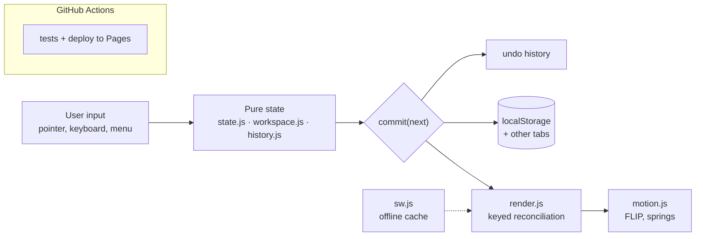

# Drafty

**A Kanban board styled like a technical drawing, with pointer-based drag and drop, Motion animations and offline support, in plain JavaScript.**

[](https://github.com/zSamir015/drafty/actions/workflows/test.yml)
[](LICENSE)

**English** | [Español](README.es.md)

Drafty is a Kanban board styled like a technical drawing. It is written in plain JavaScript with no framework and no build step, and the interface is in Spanish.

The interesting part is the interaction layer: drag and drop is built on pointer events instead of the HTML5 drag API, the board re-renders by reconciling keyed nodes, and every change goes through one function that records history, saves and redraws. All of it works with the keyboard and offline.

**[Live demo →](https://zsamir015.github.io/drafty/)** · [Security policy](SECURITY.md)


| Light                                               | Dark                                              | Mobile                                |
| --------------------------------------------------- | ------------------------------------------------- | ------------------------------------- |
|  |  |  |

## Tech stack

[](#how-it-works)

JavaScript ES modules · HTML · CSS · Motion (vendored) · Service worker + Web App Manifest · node --test · GitHub Actions + Pages

## Quickstart

```sh
git clone https://github.com/zSamir015/drafty.git && cd drafty
npm run dev   # http://localhost:5173
npm test
```

## Contents

- [Features](#features)
- [How it works](#how-it-works)
- [Drag and drop](#drag-and-drop)
- [Rendering and animation](#rendering-and-animation)
- [Storage and data format](#storage-and-data-format)
- [Offline support](#offline-support)
- [Security](#security)
- [Accessibility](#accessibility)
- [Testing and CI](#testing-and-ci)
- [Running it locally](#running-it-locally)
- [Project layout](#project-layout)
- [Limitations](#limitations)
- [License and credits](#license-and-credits)

## Features

- Three columns (to do, in progress, done) and several boards in tabs. Boards can be created, renamed with a double click and deleted.
- Cards with a title, priority, label and due date. Overdue cards are flagged.
- Drag and drop with mouse or touch (long press on touch). `Esc` cancels a drag, and the page scrolls when you drag near the top or bottom edge.
- Undo and redo with `Ctrl+Z` and `Ctrl+Shift+Z`, up to 100 steps. Deleting a card also shows an "Undo" toast.
- Live search by title, label or card code (for example `TK-007`).
- A work-in-progress limit on the "in progress" column, which is highlighted when it goes over.
- A progress bar and a title block that counts revisions, in keeping with the drawing theme.
- JSON export and import of the whole workspace.
- Changes made in one tab appear in the other open tabs.
- Light and dark themes, switched with a View Transition where the browser supports it.
- Installable as a PWA and usable offline.

### Keyboard shortcuts

| Keys                      | Action                         |
| ------------------------- | ------------------------------ |
| `N`                       | New task                       |
| `/`                       | Search                         |
| `?`                       | Help                           |
| `Ctrl Z` / `Ctrl Shift Z` | Undo / redo                    |
| Arrow keys                | Move between cards             |
| `Alt` + arrow keys        | Move the focused card          |
| `Enter` / `Delete`        | Edit / delete the focused card |
| `Esc`                     | Cancel editing or dragging     |

## How it works



State and DOM are kept apart. The state modules (`state.js`, `workspace.js`, `history.js`) are pure functions over plain objects: they never touch the DOM and never mutate their input. Everything else reads that state and turns user input into calls to those functions.

Every change goes through a single `commit(next)` in `main.js`:

1. If the new workspace is the same object as the current one, nothing happens.
2. Otherwise the current workspace is pushed onto the undo history.
3. The new workspace is saved to `localStorage`.
4. The board is redrawn.

Because the state is immutable, "nothing changed" is a reference comparison, undo is just restoring an earlier object, and the history never needs deep copies. Drag and drop, the keyboard and the "Move to" menu all end up calling the same `moveCard` function, so a card moved in any of the three ways behaves identically and is undone the same way.

## Drag and drop

The native HTML5 drag API cannot animate the dragged element and does not work on touch screens, so `dragdrop.js` implements dragging with pointer events.

- When a drag starts, the original card stays in the list as a placeholder and a copy (the "ghost") follows the pointer. The ghost lifts with a spring and tilts according to the pointer's speed.
- As the pointer moves, the placeholder is moved through the DOM to the slot under it, and the other cards slide out of the way with a FLIP animation. Slot positions are measured with `offsetTop`, which ignores transforms that are still animating, so the cards don't jitter.
- Within 64px of the top or bottom of the window the page scrolls, faster the closer the pointer is to the edge.
- On drop, the module only reports `onMove(id, column, index)`. It knows nothing about the state; `main.js` turns that into a `moveCard` commit.

## Rendering and animation

`render.js` draws a board from its state by reconciling keyed nodes, a small version of what virtual-DOM libraries do. Existing card elements are reused and updated in place, new ones are created, removed ones animate out, and only the cards that actually changed are animated. Replacing a card's element when it changes column would break an ongoing drag and its animations, so elements are moved instead.

All animation goes through `motion.js`, the only module that uses [Motion](https://motion.dev). It defines the springs used across the app for entrances, exits, counters, toasts and the "done" stamp. With `prefers-reduced-motion` every animation becomes a short fade with no movement.

## Storage and data format

The workspace is stored as JSON under the `drafty:state` key in `localStorage`. It is a versioned object (`version: 2`) with the id of the active board and a list of boards, each with a name, an optional WIP limit and its cards.

Older saves from the single-board version are a bare board state. On load, `migrate()` accepts either shape: a valid workspace is used as is, a valid single board is wrapped into a new workspace, and anything else is discarded in favour of an empty board. Invalid JSON or an unavailable `localStorage` (private browsing in some browsers) also falls back to an empty board instead of breaking the app.

Other tabs are kept in sync through the `storage` event, which fires in every other tab when one of them writes. The incoming value goes through the same `migrate()` validation.

Export downloads the workspace as a JSON file. Import accepts files up to 5 MB, runs them through `migrate()` and only replaces the workspace if the whole file is valid.

## Offline support

The service worker (`sw.js`) precaches the app shell (HTML, CSS, JavaScript, Motion, fonts and icons) under a versioned cache name. Requests go to the network first and fall back to the cache when offline, so a deploy is picked up on the next visit while the app still opens without a connection. When a new version activates, older caches are deleted.

## Security

- A strict Content Security Policy limits scripts, styles, fonts, images and connections to the site's own origin, with no inline scripts and `object-src 'none'`. That is also why Motion is committed under `vendor/` instead of loaded from a CDN.
- User text is only ever written with `textContent` or text nodes, never `innerHTML`.
- Imported files are treated as untrusted input: size-limited and fully validated before use.
- Nothing is sent to a server. There are no accounts, analytics or third-party requests.

## Accessibility

Everything can be done from the keyboard, including moving cards between columns and within a column. Moves, deletions and undo are announced to screen readers through a live region, focus is preserved across re-renders, and reduced motion is respected throughout.

## Testing and CI

```sh
npm test   # node --test, no dependencies
```

The tests cover the pure modules: board state (adding, editing, moving and deleting cards, validation), the workspace (multiple boards, WIP limits and migration from the old format) and the undo history. They run on every push to `main` and on every pull request through the `Tests` workflow.

The site is deployed by GitHub Pages straight from `main`, since there is nothing to build.

## Running it locally

ES modules do not load from `file://`, so serve the folder with any static server:

```sh
npm run dev   # python3 -m http.server 5173
# or: npx serve .
```

Then open http://localhost:5173.

## Project layout

```
index.html          markup and the Content Security Policy
css/styles.css      styles and theme variables
js/
  state.js          single-board state, pure and immutable
  workspace.js      multiple boards, WIP limit, migration from v1; pure
  history.js        undo and redo; pure
  storage.js        localStorage, cross-tab sync, export and import
  render.js         keyed reconciliation of the board
  motion.js         every animation, through Motion
  dragdrop.js       pointer-event drag and drop
  keyboard.js       shortcuts and keyboard movement
  toast.js          notifications with an action button
  theme.js          light and dark theme (theme-init.js applies it before first paint)
  tilt.js           3D tilt on hover
  main.js           wires the modules together and owns commit()
sw.js               service worker
vendor/             Motion 14.0.0 (UMD build)
fonts/, icons/      self-hosted Monaspace fonts and app icons
test/               node --test suites for the pure modules
```

## Limitations

- Boards live in one browser. There are no accounts or cloud sync; export and import are the way to move a workspace.
- The interface is only in Spanish.
- Automated tests cover the pure logic. Drag and drop, keyboard flows and rendering are tested by hand; browser tests with Playwright and an axe scan in CI would be the next step.

## License and credits

The code is under the [MIT license](LICENSE), © 2026 Samir Lorenzo.

- [Motion](https://motion.dev) for animation (MIT).
- [Monaspace](https://monaspace.githubnext.com) typeface (SIL OFL 1.1).
- The toast design is inspired by [Sileo](https://github.com/hiaaryan/sileo).
